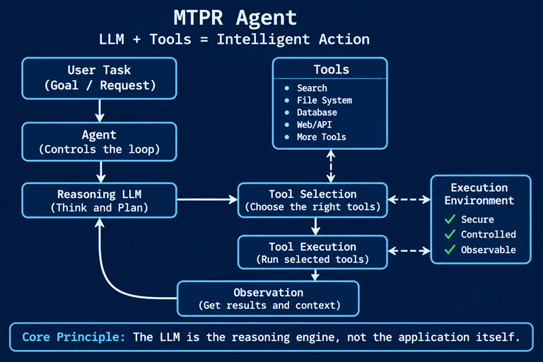
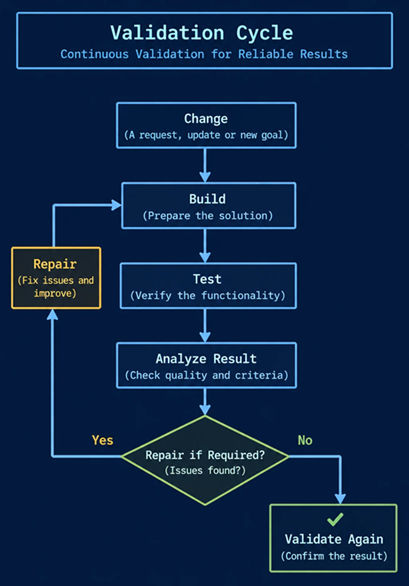
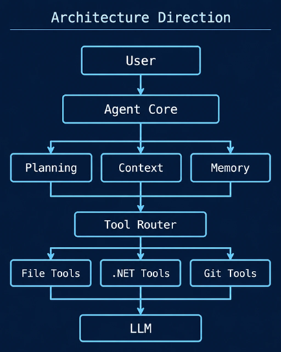
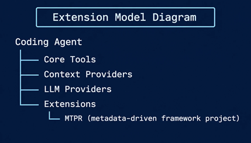
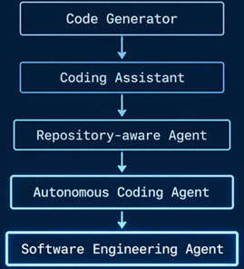

# About MTPR Agent

- [Back to index](index.md)

## Overview

MTPR Agent is a general-purpose AI coding agent built with .NET. The name MTPR is derived from the author's family name, Matapour, with its vowels removed.

License: Apache License 2.0.

The goal is to create an autonomous software engineering agent capable of understanding a software repository, planning implementation work, modifying source code, executing development tools, validating changes, and iterating based on the results.

The project is inspired by modern coding agents such as Claude Code and Codex, but is designed with a .NET-first architecture and extensibility model.

The agent is delivered as a cross-platform desktop application for Windows, macOS, and Linux. A WebAssembly (browser) target is planned for later.

## Vision

Build a coding agent that can work with a software repository as an autonomous development environment rather than simply generating code from prompts.

The agent should eventually be able to:

- Understand an existing repository
- Explore and analyze source code
- Understand project structure and dependencies
- Plan implementation tasks
- Modify source files
- Create new files
- Run builds and tests
- Diagnose compilation and test failures
- Iteratively repair its implementation
- Work with Git
- Review its own changes
- Create meaningful commits
- Use project-specific extensions
- Operate with different LLM providers

## Core Principle

The LLM is the reasoning engine, not the application itself.

The agent should provide the LLM with controlled capabilities through tools and should own the execution loop around those tools.

## Project Scope

The initial project focuses on software development tasks.

The core agent should remain independent of any specific application framework or metadata system.

MTPR will be integrated later as an optional extension rather than being part of the core agent.

## Platforms and User Interface

- **Platforms:** Windows, macOS, and Linux.
- **UI:** Avalonia desktop application (chat, repository selection, tool-activity view, approvals and settings).
- **Later:** WebAssembly (browser) target for the same UI.
- **Runtime:** C# on .NET 10.

## Core Capabilities

### Repository Understanding

The agent should be able to inspect:

- Directory structure
- Source files
- Project files
- Solution files
- Dependencies
- Tests
- Configuration
- Git history

### Code Modification

The agent should be able to:

- Create files
- Modify files
- Delete files when explicitly allowed
- Apply targeted changes
- Refactor existing code

### Development Execution

The agent should be able to execute controlled development commands such as:

- `dotnet build`
- `dotnet test`
- `dotnet restore`
- Git commands
- Project-specific commands

### Validation

Every implementation should preferably follow a validation cycle:

## Architecture Direction

The architecture is expected to evolve around the following concepts:

This architecture is intentionally modular so that LLM providers, tools, context mechanisms, and extensions can evolve independently.

## LLM Independence

The agent should not be tightly coupled to a single LLM provider.

The architecture should allow implementations such as:

- Local models
- OpenAI-compatible APIs
- Cloud providers
- Other future providers

The first provider implementation is GapGPT. Other providers, including OpenAI, Anthropic, OpenAI-compatible APIs, Google, and local models, are planned and will be added incrementally behind the same abstraction.

## Context Strategy

The initial implementation should not depend on a traditional RAG architecture.

Repository understanding should primarily use direct tools and structured code/project analysis.

Potential future context mechanisms include:

- Repository indexing
- Semantic search
- Roslyn-based analysis
- Project metadata
- Documentation retrieval
- RAG for external or project knowledge

## Extension Model

The core agent should support extensions/plugins.

An extension may provide:

- New tools
- New context providers
- Domain-specific knowledge
- Specialized workflows
- Project-aware capabilities

MTPR(see [MTPR Project](https://github.com/HamedMtpr/MTPR)) is planned as the first major domain-specific extension.

## .NET-First Approach

The project is designed primarily for the .NET ecosystem.

Potential technologies include:

- C#
- .NET
- Roslyn
- `dotnet CLI`
- Git
- xUnit
- Dependency Injection
- Structured logging
- JSON-based tool protocols

The architecture should avoid unnecessary coupling to .NET-specific concepts where they would prevent future extensibility.

## Non-Goals

The first versions are not intended to:

- Build a complete IDE
- Replace Visual Studio or VS Code
- Implement a general-purpose chatbot
- Implement a full RAG platform
- Fully automate every software engineering workflow
- Depend on MTPR

## Long-Term Vision

The long-term goal is to evolve from a code-generation assistant into an autonomous software engineering system capable of handling increasingly complex repository-level tasks.
